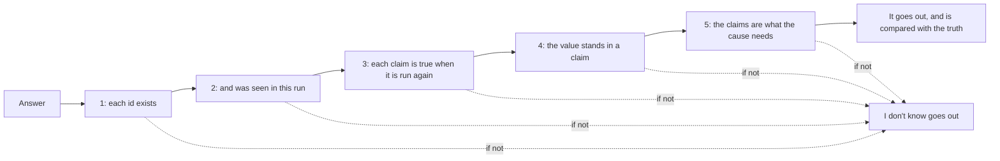

# ai-ops-agent

Part of the public portfolio of Luis Orozco. The other repositories stand at [github.com/oplf-svg](https://github.com/oplf-svg).

An agent that looks into failures of [webhook-platform](https://github.com/oplf-svg/webhook-platform). It answers with evidence or
says that it does not know, and it can only read. The company behind it is made up: no shop, customer or order in here is real.

## The claims

> It answers from checked data, or says that it does not know.
>
> It names the cause of a failure, or says that nobody can know it. Its misses are published, and it cannot act.
>
> An instruction that somebody planted in the data is never followed.

None of them is shown yet. **What exists is the part that will judge the agent**, and it came first on purpose:

| | |
|---|---|
| [What it has to survive](docs/contract.md) | 28 things that can happen, and what must be true afterwards. Four more come later |
| [The grader](grader) | Code without a model, a network or a package. It runs every claim of an answer again, and believes nothing that a model wrote |
| [What a cause needs](evidence/causes.txt) | What has to be shown before a cause may be named. Drafted by Claude and corrected by the owner, and so far it is a form |
| [Tests that can fail](tests/wrong.py) | More than 300 mistakes that are easy to make, one at a time. The tests have to notice each of them, and each test has to be able to fail |

The numbers of each run are on its summary page under [Actions](../../actions/workflows/ci.yml).

## How an answer is judged



- **A number or an absence rests on a search** that this run really made, with the same conditions. In a source that was not
  recorded all the time, neither is accepted.
- **Being caught is not being right.** Where nobody can know, only an answer that says so by itself is right.
- **No answer is not "I don't know".** A refusal, a cut-off text or a limit that stopped the run is a result of its own.
- **The table of causes is checked without a model.** For each recording it may let only the true cause through. Then no wrong cause
  can go out, whatever a model writes. Its price: with that, code alone finds every cause. So the agent is never compared with
  nothing, and nobody should read its score as better than rules.
- **The harness can be wrong as well.** If another model replied, or a tool showed what is not there, there is no result.

## What it does not do yet

- There is no agent, no recording and no model in here.
- The table of causes is still a form.
- It does not run anywhere but in tests. AWS, Azure and Google Cloud come later.

## Run the tests

They need Python 3.10 or newer and nothing else.

```bash
bash .github/scripts/tests.sh
bash .github/scripts/wrong.sh
```

## Who made this

Directed and approved by Luis Orozco. Code, tests and texts are written by Claude, an AI agent that proposes its changes under an
identity of its own. What a cause needs is drafted by Claude and corrected by the owner, and each line that the owner wrote or changed
is marked. So far it is an empty form, and so is the list of runbooks. The word `never` below twenty causes is nobody's judgement: it
has to follow from a check of the recordings that is still to come.

Licensed under the [Apache License 2.0](LICENSE), see also [NOTICE](NOTICE).
